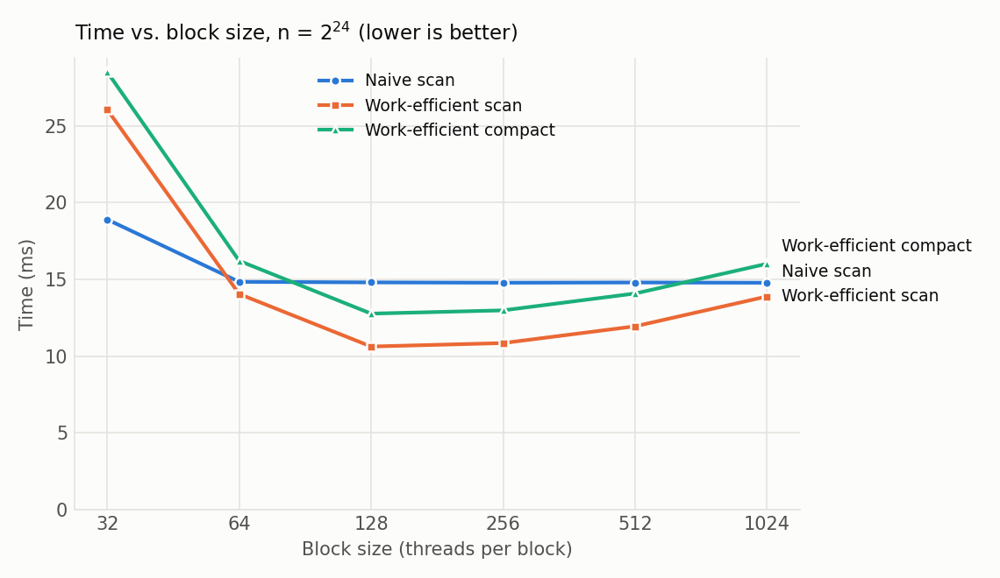
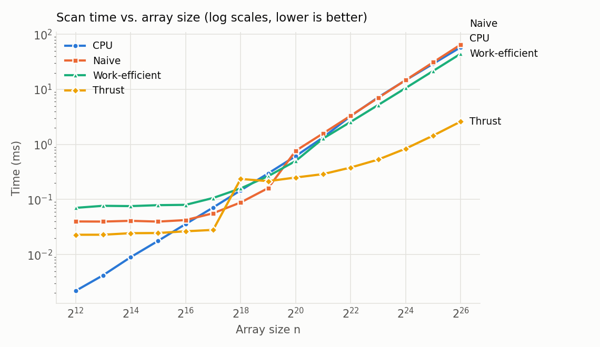
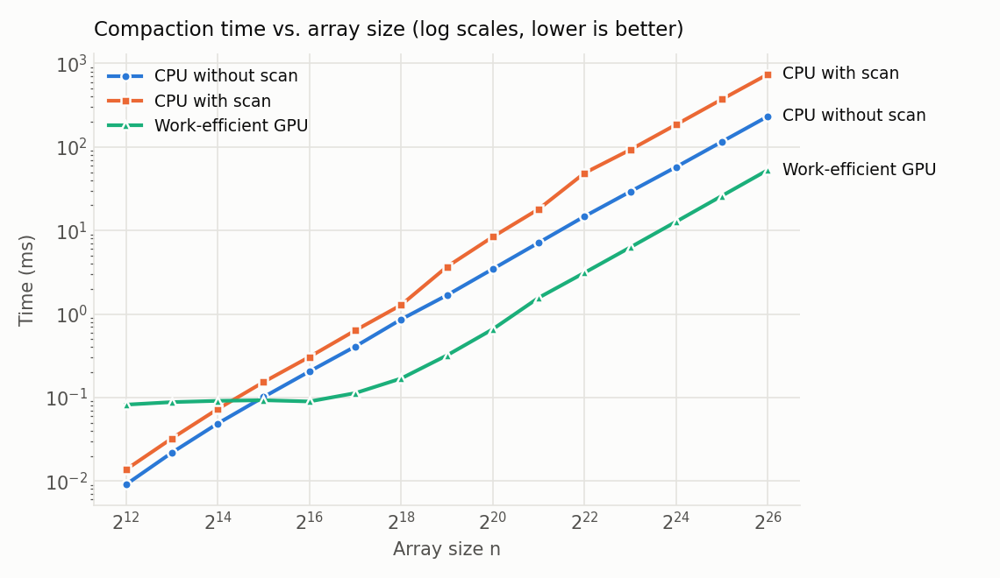

CUDA Stream Compaction
======================

**University of Pennsylvania, CIS 565: GPU Programming and Architecture, Project 2**

* Josh Kim
  * [LinkedIn](https://www.linkedin.com/in/euikwang-kim), [personal website](https://euikwang.com)
* Tested on: Ubuntu 22.04.5 LTS, Intel Xeon @ 2.30GHz (4 vCPUs), 15 GB RAM, NVIDIA Tesla T4 16 GB (Google Cloud VM), CUDA 13.3, driver 610.57

## Overview
This project implements GPU stream compaction in CUDA from scratch. Along the way it implements an exclusive scan (prefix sum) on the CPU, a naive GPU scan, a work-efficient GPU scan, and a scan with NVIDIA's Thrust library, and compares how their performance depends on block size and array size.

### Features

* **CPU**: `scan`, `compactWithoutScan`, `compactWithScan`
* **Naive GPU scan**:
* **Work-efficient GPU scan**
* **Work-efficient GPU stream compaction**
* **Thrust scan**

## Performance analysis
All measurements use a Release build. The timers only cover the algorithm: the initial and final `cudaMalloc`/`cudaMemcpy` calls are outside them, so the numbers do not include memory allocation or copies between the CPU and the GPU. Each number is the median of 20 runs (two passes of 10, after warm-up runs) from a small timing program that calls the same functions.


### Block size



**n = 2^24** (ms)

| Block size | Naive scan | Work-efficient scan | Work-efficient compact |
|---:|---:|---:|---:|
| 32 | 18.900 | 26.061 | 28.514 |
| 64 | 14.838 | 14.045 | 16.206 |
| 128 | 14.801 | 10.623 | 12.767 |
| 256 | 14.780 | 10.848 | 12.979 |
| 512 | 14.796 | 11.940 | 14.077 |
| 1024 | 14.778 | 13.885 | 16.013 |

I kept a block size of 128 for all GPU kernels. The naive scan takes the same time from 64 to 1024, and the work-efficient scan is fastest at 128.

Block size 32 is the slowest of both. A T4 SM can hold at most 16 blocks and 1024 threads at a time, so with 32-thread blocks it only gets 16 * 32 threads, half of what it could run. With fewer threads in flight, the SM has less other work to switch to while threads wait for memory. There are also 4 times as many blocks to launch as at 128.

The naive scan is flat from 64 up because each pass is limited by memory bandwidth. A pass reads and writes the whole array at about 240 GB/s which is the speed of a plain device-to-device `cudaMemcpy` on this GPU. Once there are enough threads per SM to keep memory busy, grouping them into bigger or smaller blocks does not change how much data has to move.

The work-efficient scan is different because most of its levels have only a few working threads per block
Nsight Systems shows where the time changes (up-sweep at n = 2^24):

| Block size | Blocks per launch | Level 0 (µs) | Level 9 (µs) | Level 23 (µs) | Whole up-sweep (ms) |
|---:|---:|---:|---:|---:|---:|
| 32 | 524,288 | 836 | 540 | 551 | 14.5 |
| 128 | 131,072 | 541 | 180 | 166 | 5.9 |
| 1024 | 16,384 | 549 | 333 | 223 | 7.7 |

At level 0, where half the threads work, 128 and 1024 take the same time. The difference is in the later levels, where a block has only a few working threads or none. My guess is that a 1024-thread block fills a whole SM, so while its few working threads wait for memory, the SM cannot start another block. With 128-thread blocks an SM holds 8 blocks and can keep going with the others.

### Scan: CPU vs. GPU



**Block size 128** (ms)

| n | CPU | Naive | Work-efficient | Thrust |
|---:|---:|---:|---:|---:|
| 2^12 | 0.002 | 0.040 | 0.070 | 0.023 |
| 2^14 | 0.009 | 0.041 | 0.076 | 0.024 |
| 2^16 | 0.036 | 0.042 | 0.080 | 0.026 |
| 2^18 | 0.147 | 0.088 | 0.159 | 0.236 |
| 2^20 | 0.615 | 0.767 | 0.501 | 0.251 |
| 2^22 | 3.278 | 3.331 | 2.573 | 0.381 |
| 2^24 | 14.734 | 14.802 | 10.607 | 0.841 |
| 2^26 | 58.510 | 65.308 | 44.583 | 2.611 |

The CPU is fastest up to 2^14. Its time grows with n while every GPU version has a floor it never goes below. That floor is the fixed cost of launching kernels. Naive launches `ilog2ceil(n)` + 1 kernels (13 at 2^12) and the work-efficient scan about twice as many (24 kernels and a memset at 2^12) which is why the work-efficient scan is slower than naive up to 2^18 since it has twice as many launches that cost more than the actual work.

For naive, every one of its log2(n) passes reads and writes the whole array, so it moves log2(n) times as much data as a single pass would. Each pass runs at the GPU's copy speed, so the scan is limited by memory bandwidth. The GPU has about 25 times the CPU's bandwidth here, but at 2^24 naive moves 24 times as much data, so the two end up the same (14.8 vs. 14.7 ms).

Work-efficient only does O(n), but every level launches one thread per element, so most threads have nothing to do.

Thrust is the fastest from 2^20 from up because it reads and writes the data only once. The jump between 2^17 to 2^18 seems to come from Thrust calling `cudaMalloc` and `cudaFree` for temporary storage inside `thrust::exclusive_scan` that increases in that range.

#### Why the work-efficient scan is slow

Kernel time per up-sweep level at n = 2^24, from Nsight Systems. Every level launches all 16,777,216 threads (131,072 blocks of 128). The down-sweep is the same in reverse.

| Level d | Threads with work | Time (µs) |
|---:|---:|---:|
| 0 | 8,388,608 | 541 |
| 1 | 4,194,304 | 548 |
| 2 | 2,097,152 | 548 |
| 3 | 1,048,576 | 415 |
| 4 | 524,288 | 382 |
| 5 | 262,144 | 282 |
| 6 | 131,072 | 250 |
| 7 | 65,536 | 207 |
| 8 | 32,768 | 192 |
| 10 | 8,192 | 172 |
| 12 | 2,048 | 169 |
| 16 | 128 | 167 |
| 23 | 1 | 167 |

At level d only n / 2^(d+1) threads have work, but every level still launches one thread per element.

Levels 0 to 2 take the same time even though the number of working threads halves each time. The working threads are only 2, 4 and 8 elements apart, so the kernel still reads and writes memory all over the array. These levels take about as long as one naive pass, which runs at copy speed, so memory traffic sets the time, not the number of threads.

After that the time drops as the working threads get further apart, but it stops at about 167 µs around level 10. From level 8 on most blocks have no working thread at all, yet all 131,072 blocks are still launched, and every thread still computes its index and a modulo before finding out it has nothing to do.

The fix would be to launch only the threads that have work at each level, n / 2^(d+1) of them, and compute each one's position from its thread index, so the deep levels launch only a few blocks.

#### Thrust (Nsight Systems)

One call of `Thrust::scan` at n = 2^24:

| Step | Inside the timer? | Time (ms) |
|---|:---:|---:|
| `device_vector` copy in (host to device, 64 MB) | no | 14.5 |
| `device_vector` zero fill (`for_each` kernel) | no | 0.28 |
| `cudaMalloc` (temporary storage) | yes | 0.23 |
| `DeviceScanInitKernel` (69 blocks of 128) | yes | 0.002 |
| `DeviceScanKernel` (8,739 blocks of 128) | yes | 0.58 |
| `cudaFree` | yes | 0.13 |
| `thrust::copy` out (device to host, 64 MB) | no | 14.6 |

Thrust runs only two kernels. `DeviceScanInitKernel` is tiny, and `DeviceScanKernel` does the whole scan in one launch of 8,739 blocks of 128 threads. That is about 1,920 elements per block, or 15 per thread, instead of one thread per element and 48 launches. The kernel names (Thrust calls CUB, and the init kernel sets up a `ScanTileState`) suggest that each block scans its own tile and gets the total of all tiles before it from the blocks ahead of it, so the data goes through memory only once. At 2^24 that one pass moves 128 MB in 0.58 ms, about 230 GB/s, close to the 240 GB/s copy speed. So Thrust is limited by memory bandwidth too, but it only needs one trip through memory, where naive needs 24.

### Stream compaction



**Block size 128** (ms)

| n | CPU without scan | CPU with scan | Work-efficient GPU |
|---:|---:|---:|---:|
| 2^12 | 0.009 | 0.014 | 0.082 |
| 2^14 | 0.049 | 0.073 | 0.091 |
| 2^16 | 0.205 | 0.306 | 0.090 |
| 2^18 | 0.862 | 1.281 | 0.169 |
| 2^20 | 3.461 | 8.393 | 0.658 |
| 2^22 | 14.757 | 48.731 | 3.122 |
| 2^24 | 57.662 | 185.591 | 12.772 |
| 2^26 | 232.945 | 743.401 | 53.086 |

The GPU compaction is faster than both CPU versions from 2^16 up. Most of the GPU time is the work-efficient scan.

The CPU with scan is about 3 times slower than the CPU without scan. It makes three passes over the data (map, scan, scatter) instead of one, and writes two extra arrays of n ints. Those two arrays are allocated with `new[]` just before the timer starts and written for the first time inside it, so every call also pays a page fault for each 4 KB page of them.

## Test output

`SIZE = 1 << 24` in `src/main.cpp`:

```
****************
** SCAN TESTS **
****************
    [  32  18  44  26  19   9   5  16  39   1   1  36  38 ...   4   0 ]
==== cpu scan, power-of-two ====
   elapsed time: 15.6222ms    (std::chrono Measured)
    [   0  32  50  94 120 139 148 153 169 208 209 210 246 ... 411048641 411048645 ]
==== cpu scan, non-power-of-two ====
   elapsed time: 15.7356ms    (std::chrono Measured)
    [   0  32  50  94 120 139 148 153 169 208 209 210 246 ... 411048516 411048562 ]
    passed
==== naive scan, power-of-two ====
   elapsed time: 14.9934ms    (CUDA Measured)
    passed
==== naive scan, non-power-of-two ====
   elapsed time: 14.8055ms    (CUDA Measured)
    passed
==== work-efficient scan, power-of-two ====
   elapsed time: 17.7201ms    (CUDA Measured)
    passed
==== work-efficient scan, non-power-of-two ====
   elapsed time: 17.6339ms    (CUDA Measured)
    passed
==== thrust scan, power-of-two ====
   elapsed time: 0.926816ms    (CUDA Measured)
    passed
==== thrust scan, non-power-of-two ====
   elapsed time: 0.886816ms    (CUDA Measured)
    passed

*****************************
** STREAM COMPACTION TESTS **
*****************************
    [   0   2   2   3   3   2   0   3   3   1   3   0   0 ...   2   0 ]
==== cpu compact without scan, power-of-two ====
   elapsed time: 56.8042ms    (std::chrono Measured)
    [   2   2   3   3   2   3   3   1   3   2   1   3   2 ...   3   2 ]
    passed
==== cpu compact without scan, non-power-of-two ====
   elapsed time: 57.4649ms    (std::chrono Measured)
    [   2   2   3   3   2   3   3   1   3   2   1   3   2 ...   2   2 ]
    passed
==== cpu compact with scan ====
   elapsed time: 195.091ms    (std::chrono Measured)
    [   2   2   3   3   2   3   3   1   3   2   1   3   2 ...   3   2 ]
    passed
==== work-efficient compact, power-of-two ====
   elapsed time: 18.9483ms    (CUDA Measured)
    passed
==== work-efficient compact, non-power-of-two ====
   elapsed time: 18.8923ms    (CUDA Measured)
    passed
```
